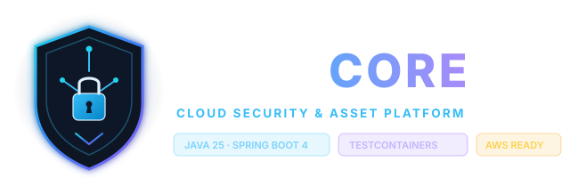

<p align="center">
  
</p>

# AegisCore — Enterprise Cloud Asset & Audit Management Platform

[](https://openjdk.org/)
[](https://spring.io/projects/spring-boot)
[](https://www.postgresql.org/)
[](https://testcontainers.com/)
[](https://www.docker.com/)
[](https://github.com/davifeels/aegis-core/actions)
[](LICENSE)

> **AegisCore** é uma solução backend corporativa de alta resiliência e segurança desenvolvida para governança, inventário e auditoria imutável de ativos em nuvem. Projetada sob as mais modernas práticas de engenharia de software — incluindo **Java 25**, **Spring Boot 4**, **PostgreSQL 18**, controle de acesso granular por papéis (**RBAC**), pipeline de migração automatizada de banco com **Flyway** e testes de integração de ponta a ponta com **Testcontainers**.

---

## 📌 Sumário Executivo & Destaques de Engenharia

- **Arquitetura Event-Driven para Auditoria:** Cada mutação de estado em ativos (`CREATE`, `UPDATE`, `DELETE`) emite um evento desacoplado de domínio (`AssetAuditEvent`) processado via `@EventListener`, garantindo persistência transacional sem penalizar o throughput de leitura/escrita do ativo.
- **Segurança Defensiva e Granular (RBAC):** Proteção via Spring Security com autenticação HTTP Basic, hashing criptográfico de senhas via `BCrypt` com fator de trabalho seguro, distinção rigorosa de privilégios (`ROLE_ADMIN` vs `ROLE_USER`) e sanitização de credenciais.
- **Banco de Dados Evolutivo & Versionado:** Schemas controlados rigorosamente via **Flyway Migrations** (`V1__init_schema.sql`, `V2__seed_default_users.sql`), assegurando reprodutibilidade exata em ambientes de staging e produção com PostgreSQL 18.
- **Confiabilidade Garantida com Testcontainers:** Suíte de testes automatizados com testes unitários (JUnit 5 + Mockito) e testes de integração que sobem contêineres reais descartáveis de PostgreSQL durante a execução do Maven, eliminando inconsistências de mocks em memória.
- **Continuous Integration (CI):** Pipeline no GitHub Actions validando compilação, testes unitários, testes de integração e empacotamento a cada `push` e `pull_request`.
- **Pronto para Produção (Cloud-Ready):** Imagem conteinerizada via `Dockerfile` multi-stage com JVM otimizada, orquestração local imediata via `docker-compose` e blueprint completo para implantação em escala na **AWS**.

---

## 🏛️ Arquitetura do Sistema

```
                       ┌────────────────────────┐
                       │   Clients / Consumers   │
                       └───────────┬────────────┘
                                   │ HTTPS / REST
                                   ▼
                       ┌────────────────────────┐
                       │   Spring Security      │
                       │   (RBAC / BCrypt / Auth)│
                       └───────────┬────────────┘
                                   │
         ┌─────────────────────────┴─────────────────────────┐
         │                                                   │
         ▼                                                   ▼
┌─────────────────────────┐                         ┌─────────────────────────┐
│  CloudAssetController   │                         │  AssetAuditController   │
│  (/api/v1/assets)       │                         │  (/api/v1/audit-logs)   │
└───────────┬─────────────┘                         └───────────▲─────────────┘
            │                                                   │
            ▼                                                   │
┌─────────────────────────┐                         ┌───────────┴─────────────┐
│    CloudAssetService    │                         │    AssetAuditService    │
│  - CRUD Ativos Cloud    │                         │  - Consulta Filtrada    │
│  - Validação de Domínio │                         │  - Paginação & Período  │
└───────────┬─────────────┘                         └───────────▲─────────────┘
            │                                                   │
            │ publishes (Spring Events)                         │ reads
            ▼                                                   │
 ┌─────────────────────┐      persists      ┌───────────────────┴─┐
 │   AssetAuditEvent   ├───────────────────►│   AssetAuditEntry   │
 └─────────────────────┘                    └───────────┬─────────┘
            │                                           │
            ▼                                           ▼
┌─────────────────────────────────────────────────────────────────┐
│               PostgreSQL 18 (Managed via Flyway)                │
│    - tb_cloud_assets       - tb_asset_audit_logs                │
│    - tb_users              - tb_roles                           │
└─────────────────────────────────────────────────────────────────┘
```

---

## 🚀 Funcionalidades Principais

### 1. Gestão Completa de Ativos Cloud (`/api/v1/assets`)
- **Cadastro de Ativos:** Registro com validações de unicidade de identificador de recurso (ARN/ID), classificação por tipo (ex: `EC2`, `S3`, `RDS`, `KMS`), ambiente (`PRODUCTION`, `STAGING`, `DEVELOPMENT`) e status de conformidade.
- **Consulta Paginada & Filtros:** Busca paginada por ambiente, provedor cloud, tags de custo e status operacional.
- **Atualização com Detecção de Drift:** Atualização granular de metadados, IP, portas e status de conformidade.
- **Deleção Segura:** Exclusão lógica/física com publicação automática de registro de auditoria e controle restrito à permissão de administrador.

### 2. Trilha de Auditoria & Compliance Imutável (`/api/v1/audit-logs`)
- Registro obrigatório de quem executou a ação (`principal`), qual ação (`CREATE`, `UPDATE`, `DELETE`), qual ativo foi afetado (`asset_id`), endereço IP de origem e timestamp em UTC.
- Consulta avançada com suporte a filtros combinados:
  - Filtragem por tipo de ação (`action`).
  - Filtragem por identificador de ativo (`assetId`).
  - Filtragem por intervalo de datas (`startDate` e `endDate`).
  - Paginação via Spring Data (`page`, `size`, `sort`).

### 3. Matriz de Autorização (RBAC)

| Endpoint | Método | Descrição | Permissão Mínima |
|:---|:---:|:---|:---:|
| `/api/v1/assets` | `GET` | Listar ativos em nuvem (paginado) | `ROLE_USER` / `ROLE_ADMIN` |
| `/api/v1/assets/{id}` | `GET` | Buscar detalhes do ativo | `ROLE_USER` / `ROLE_ADMIN` |
| `/api/v1/assets` | `POST` | Cadastrar novo ativo | `ROLE_ADMIN` |
| `/api/v1/assets/{id}` | `PUT` | Atualizar configurações de ativo | `ROLE_ADMIN` |
| `/api/v1/assets/{id}` | `DELETE` | Remover ativo do inventário | `ROLE_ADMIN` |
| `/api/v1/audit-logs` | `GET` | Consultar trilha de auditoria | `ROLE_ADMIN` |
| `/actuator/health` | `GET` | Health check da aplicação | Público |
| `/swagger-ui/**` | `GET` | Documentação interativa da API | Público |

---

## 🛠️ Stack Tecnológica

| Componente | Tecnologia | Finalidade / Justificativa |
|:---|:---|:---|
| **Linguagem** | Java 25 | LTS de última geração com melhorias no compilador e Virtual Threads |
| **Framework** | Spring Boot 4.1.1 | Ecossistema moderno para microserviços e APIs corporativas |
| **Segurança** | Spring Security | Autenticação, RBAC, hash com BCrypt e proteção de endpoints |
| **Persistência** | Spring Data JPA / Hibernate | Mapeamento relacional e abstração de repositórios |
| **Banco de Dados** | PostgreSQL 18 | SGBD relacional ACID de alta confiabilidade para cargas enterprise |
| **Migrações** | Flyway | Versionamento determinístico do esquema e dados sementes |
| **Testes Unitários** | JUnit 5 & Mockito | Cobertura de regras de negócio em isolamento |
| **Testes de Integração** | Testcontainers | PostgreSQL efêmero real rodando em container Docker no teste |
| **Documentação** | SpringDoc OpenAPI / Swagger | Especificação viva e interface interativa dos contratos REST |
| **Containers** | Docker & Docker Compose | Padronização e isolamento do runtime de desenvolvimento e CI |
| **CI/CD** | GitHub Actions | Automação de compilação, testes e validação contínua |
| **Nuvem Alvo** | AWS (ECS Fargate / RDS / ALB) | Infraestrutura elástica, redundante e tolerante a falhas |

---

## 🧪 Estratégia de Testes Automatizados

O AegisCore adota a pirâmide de testes para garantir integridade estrutural e comportamental:

1. **Testes Unitários:** Validação de fluxos de serviço, regras de negócio e mapeamento DTO utilizando **JUnit 5** e **Mockito**.
2. **Testes de Integração com Testcontainers:** Durante o ciclo de teste, o framework inicializa automaticamente um container real de **PostgreSQL 18** via Docker, executa as migrações do **Flyway** e roda as chamadas aos endpoints com `MockMvc` / `TestRestTemplate`.
   - **Benefício:** Zero discrepâncias de compatibilidade entre o banco de teste (frequentemente H2 com dialetos diferentes) e o banco real de produção.

Para executar toda a suíte de testes:
```bash
./mvnw clean verify
```

---

## ⚙️ Configuração & Execução Local

### Pré-requisitos
- **Java 25 JDK** instalado e configurado no `PATH`.
- **Docker** e **Docker Compose** instalados e em execução.
- Git instalado.

### 1. Clonar o Repositório
```bash
git clone https://github.com/davifeels/aegis-core.git
cd aegis-core
```

### 2. Variáveis de Ambiente
O projeto gerencia credenciais de forma estrita via variáveis de ambiente, prevenindo vazamento acidental de segredos no código-fonte. Um arquivo base `.env.example` está disponível:

```properties
# Banco de Dados
DB_HOST=localhost
DB_PORT=5432
DB_NAME=aegis_core_db
DB_USERNAME=aegis_admin
DB_PASSWORD=aegis_secure_password_123

# Servidor
SERVER_PORT=8080
SPRING_PROFILES_ACTIVE=dev

# Segurança (Sementes)
ADMIN_DEFAULT_PASSWORD=admin_super_secret_pwd
USER_DEFAULT_PASSWORD=user_secure_pwd
```

### 3. Subir com Docker Compose (Banco + Aplicação)
Para subir o banco de dados PostgreSQL 18 e o backend com um único comando:
```bash
docker compose up -d --build
```
A aplicação estará disponível em `http://localhost:8080`.

### 4. Execução Manual via Maven Wrapper (Modo Desenvolvimento)
Suba apenas o banco de dados:
```bash
docker compose up -d db
```
E inicie a aplicação Spring Boot:
```bash
./mvnw spring-boot:run
```

---

## 📖 Documentação da API (OpenAPI / Swagger)

Com a aplicação em execução, acesse a documentação interativa para testar as rotas e inspecionar os esquemas de requisição e resposta:
- **Swagger UI:** `http://localhost:8080/swagger-ui.html`
- **OpenAPI JSON:** `http://localhost:8080/v3/api-docs`

---

## ☁️ Arquitetura de Implantação em Nuvem (AWS Blueprint)

O AegisCore foi concebido desde o primeiro commit para operar em ambiente corporativo elástico na **AWS**. Abaixo está o blueprint de infraestrutura pronto para orquestração:

```
                    ┌───────────────────────────────┐
                    │  Amazon Route 53 (DNS / SSL)   │
                    └───────────────┬───────────────┘
                                    │ HTTPS (Port 443)
                                    ▼
                    ┌───────────────────────────────┐
                    │ Application Load Balancer     │
                    │ (AWS ALB - SSL Termination)   │
                    └───────────────┬───────────────┘
                                    │ HTTP (Target Group)
         ┌──────────────────────────┴──────────────────────────┐
         │ VPC Privada com 2 Availability Zones (Multi-AZ)      │
         │                                                     │
         │   ┌─────────────────────────────────────────────┐   │
         │   │ AWS ECS (Elastic Container Service)         │   │
         │   │ Fargate Tasks (Auto Scaling / 0 Server Mgt) │   │
         │   │  - Container AegisCore (JVM 25 Container)   │   │
         │   └──────────────────────┬──────────────────────┘   │
         │                          │                          │
         │                          ▼                          │
         │   ┌─────────────────────────────────────────────┐   │
         │   │ Amazon RDS Multi-AZ (PostgreSQL 18)         │   │
         │   │  - Subnets Privadas / Security Groups       │   │
         │   │  - Storage Encriptado (KMS)                 │   │
         │   └─────────────────────────────────────────────┘   │
         └─────────────────────────────────────────────────────┘
                                    │
                                    ▼
                    ┌───────────────────────────────┐
                    │ Observabilidade & Auditoria   │
                    │ - Amazon CloudWatch (Logs/M.) │
                    │ - AWS Secrets Manager         │
                    └───────────────────────────────┘
```

### Especificação dos Serviços Cloud:
1. **Compute (AWS ECS Fargate):** Execução serverless de contêineres Docker, eliminando gerenciamento de instâncias EC2, com auto-scaling automático baseado em consumo de CPU e requisições HTTP.
2. **Database (Amazon RDS for PostgreSQL 18):** Cluster gerenciado com alta disponibilidade Multi-AZ, backup contínuo automatizado e criptografia em repouso via AWS KMS.
3. **Segurança de Rede (AWS VPC):** Isolamento em subnets privadas sem IP público para a camada de dados e containers; tráfego de entrada estritamente mediado por Application Load Balancer (ALB).
4. **Gerenciamento de Segredos (AWS Secrets Manager):** Injeção em runtime das credenciais de banco e chaves de segurança através de variáveis de ambiente.
5. **Observabilidade (Amazon CloudWatch & Actuator):** Métricas de latência, taxa de erro (HTTP 5xx), métricas de JVM e logs de auditoria centralizados com retenção configurada.

> ℹ️ **Status de Publicação:** O projeto possui todas as configurações de empacotamento Docker, migrações de banco e parametrização por ambiente prontas para provisionamento via Terraform/CloudFormation na conta de destino AWS.

---

## 🔒 Boas Práticas de Segurança Implementadas

- **Princípio do Menor Privilégio:** Rotas sensíveis (como inspeção de logs de auditoria e deleção de inventário) são restritas estritamente à role `ADMIN`.
- **Criptografia Forte:** Senhas não trafegam e não são salvas em texto plano; utiliza-se `BCryptPasswordEncoder` com salt gerado individualmente por registro.
- **Isolamento de Redes:** No Docker Compose e no blueprint AWS, a base de dados reside em rede isolada, inacessível externamente sem túnel seguro.
- **Trilha de Auditoria Auditável:** Nenhuma exclusão ou alteração de ativo passa sem rastro de auditoria persistido no banco com timestamp e identidade de usuário.
- **Sanitização de Respostas de Erro:** Tratamento global de exceções via `@RestControllerAdvice` evitando stack traces e vazamento de detalhes internos do banco para clientes externos.

---

## 👨‍💻 Autor

**Davi Ferreira**  
Desenvolvedor de Software Backend | Especialista em Java, Spring Boot, Nuvem & Arquitetura Segura  
- **LinkedIn:** [linkedin.com/in/davi-dev](https://linkedin.com/in/davi-dev) *(ou conforme seu perfil)*
- **GitHub:** [@davifeels](https://github.com/davifeels)
- **Portfólio Interativo:** [davi.software](https://davi.software)

---

## 📄 Licença

Este projeto é distribuído sob a licença **MIT**. Consulte o arquivo [LICENSE](LICENSE) para mais detalhes.
